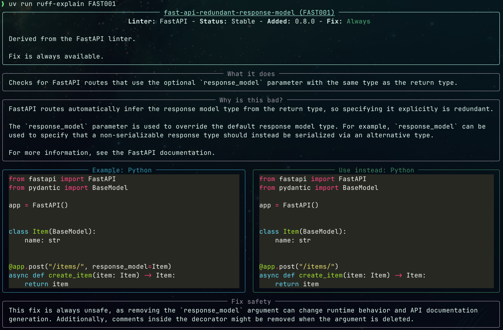

# ruff-explain

`ruff-explain` looks up Ruff rule documentation by rule ID and renders the docs page directly in your terminal with Rich.



## What it does

- Renders Ruff rule docs in the terminal by default.
- Opens the canonical docs page in your browser with `-o` / `--open`.
- Prints structured JSON for automation with `--json`.
- Prints the installed version with `-v` / `--version`.
- Resolves rule IDs like `FAST001`, `F401`, and `ARG001` from a bundled rule map.
- Keeps the output focused on the actual rule content instead of full site chrome.

## Usage

```bash
uv run ruff-explain FAST001
uv run ruff-explain F401
uv run ruff-explain ARG001 -o
uv run ruff-explain FAST001 --json
uv run ruff-explain --version
```

`--json` prints a machine-readable payload to stdout:

```json
{
  "code": "FAST001",
  "slug": "fast-api-redundant-response-model",
  "summary": "FastAPI route with redundant `response_model` argument",
  "title": "Fast API redundant response model",
  "linter": "FastAPI",
  "status": "preview",
  "since": "v0.0.243",
  "fix": "None",
  "url": "https://docs.astral.sh/ruff/rules/fast-api-redundant-response-model/",
  "overview": [
    {"type": "paragraph", "text": "Overview paragraph."}
  ],
  "sections": [
    {
      "title": "Why is this bad?",
      "blocks": [
        {"type": "paragraph", "text": "Because the response model is already inferred."}
      ]
    }
  ]
}
```

On failure, `--json` exits non-zero and prints an error payload with an `error.type` of
`unknown_rule`, `invalid_options`, `fetch_failed`, or `parse_failed`.

## Run from source

Run it from the repo with `uv`:

```bash
uv run ruff-explain FAST001
```

## Notes

- Default behavior is terminal rendering.
- `--open` skips rendering, opens the docs page immediately, and exits.
- `--json` prints structured rule data for scripts and other automation.
- `--version` prints the installed package version and exits.
- Unknown rule IDs return a non-zero exit code and show close matches when available.
